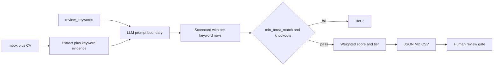

# Candidate Evaluation Framework & System Configuration

## 1. Goals & Non-Goals

### Goals (MVP)

Establish an objective, criteria-driven workflow to:

1. Ingest applicant emails and CV attachments from local Thunderbird **mbox** storage.
2. Confine each screening run to explicit **review keywords / topics**.
3. Score candidates on a unified five-dimension model with fixed weights and tier thresholds.
4. Apply data-driven knockouts (role requirements + keyword coverage).
5. Emit structured outputs (JSON, Markdown scorecards, CSV matrix) for human review.
6. Require a human gate before any rejection communication is sent.

### Non-Goals (out of MVP)

- Automatic sending of interview or rejection emails (templates are drafted; send is manual).
- Maildir / IMAP live sync (mbox only in MVP).
- OCR of scanned image-only PDFs.
- Panel scheduling, calendar integration, or ATS sync.
- **Phase 4 (offer consolidation)** — deferred; see [Section 9](#9-phase-4--future--out-of-mvp).

---

## 2. Process Requirements & Evaluation Criteria

### 2.1 Unified Screening Dimensions & Weights

Incoming applications are scored on **five dimensions** (1–5 each). These map 1:1 to the weighted algorithm (weights sum to 100%):

| Dimension ID | Screening factor (2.1) | Weight | What it measures |
| :--- | :--- | ---: | :--- |
| `role_alignment` | Role Alignment & Qualification Match | **40%** | Must-have / nice-to-have skills, years & industry relevance, education/certs — **scoped by `review_keywords`** |
| `career_progression` | Career Progression & Stability | **20%** | Growth trajectory, tenure stability, unexplained gaps / hopping |
| `application_quality` | Application Quality & Professionalism | **10%** | Email/cover clarity, CV structure/readability, attention to detail |
| `culture_fit` | Culture & Team Fit | **10%** | Values alignment and soft skills evidenced in communication |
| `operational_logistics` | Operational Logistics | **20%** | Notice/start date, salary vs band, location / working model |

**Weighted total** (0–5 scale):

```
weighted_score =
  0.40 * role_alignment
+ 0.20 * career_progression
+ 0.10 * application_quality
+ 0.10 * culture_fit
+ 0.20 * operational_logistics
```

Round to 2 decimal places for display; use full precision for tiering.

### 2.2 Topic Keywords (Review Scope)

Every screening run **must** declare `review_keywords`. The LLM scores `role_alignment` **only** on evidence related to those topics; unrelated experience is ignored for that dimension.

Config lives in [`config/role_requirements.yaml`](../config/role_requirements.yaml). CLI may override for ad-hoc runs:

```bash
python review_candidates.py --keywords "kubernetes,react,system design,remote"
```

Rules:

- Empty keyword list is **rejected** (hard error before any LLM call).
- `--keywords` replaces the YAML list for that run only.
- Exact keyword list used is persisted on every candidate record for audit / re-run comparison.

**Keyword policy** (defaults):

| Field | Default | Meaning |
| :--- | :--- | :--- |
| `match_mode` | `semantic` | LLM judges topical relevance; not string-only match |
| `min_must_match` | `2` | Knockout → Tier 3 if fewer than N keywords evidenced as `present` |
| `weight_in_role_alignment` | `0.5` | Half of `role_alignment` comes from keyword coverage/strength; half from broader must-have fit *within* those topics |

Per-keyword evidence shape:

```json
{
  "keyword": "kubernetes",
  "present": true,
  "strength": 4,
  "evidence": "Led migration of payments service to EKS",
  "source": "cv"
}
```

`keyword_coverage = count(present) / len(review_keywords)`.

### 2.3 Rubric Anchors (1 / 3 / 5)

| Dimension | 1 — Weak | 3 — Adequate | 5 — Strong |
| :--- | :--- | :--- | :--- |
| Role Alignment | Few/no keyword topics evidenced; missing must-haves | Meets min years; some must-haves + keyword coverage at policy floor | Exceeds must-haves; strong evidence on most keywords |
| Career Progression | Frequent unexplained hops/gaps; flat or regressive titles | Stable tenure; some upward movement | Clear growth; promotions or increasing scope |
| Application Quality | Generic, error-heavy, untailored | Clear structure; minor issues | Tailored, polished, easy to scan |
| Culture Fit | Tone conflicts with stated values or is purely transactional | Neutral professional tone; limited soft-skill signal | Explicit collaboration/ownership language aligned to values |
| Operational Logistics | Outside location/comp/notice constraints | Within band with minor friction (e.g. long notice) | Fully compatible on location, start, and compensation |

### 2.4 Knockout Criteria

Knockouts are **data-driven** from [`config/role_requirements.yaml`](../config/role_requirements.yaml), not prose examples.

A candidate **fails knockout** (forced Tier 3) if any of:

1. Keyword `present` count < `keyword_policy.min_must_match`
2. Any `knockouts.*` rule fails (work authorization, required license, location policy, max notice days, salary above band ceiling when disclosed)
3. Missing contact email after parse (cannot proceed operationally)

Knockout results are recorded as `knockout_status: pass | fail` plus `knockout_reasons[]`.

### 2.5 Tier Thresholds

Applied **after** knockouts:

| Tier | Label | Rule | Default action |
| :--- | :--- | :--- | :--- |
| **Tier 1** | Strong Match | `knockout_status = pass` AND `weighted_score >= 4.00` | Queue for interview invite (human sends) |
| **Tier 2** | Potential Match | `knockout_status = pass` AND `3.00 <= weighted_score < 4.00` | Backup / further screening |
| **Tier 3** | Unsuitable | Knockout fail **OR** `weighted_score < 3.00` | Rejection queue — **human confirmation required before send** |

Optional soft gate: if `role_alignment < 3`, prefer Tier 2 even when weighted ≥ 4.00 (document override in audit as `tier_override_reason`).

---

## 3. Role Requirements Config Schema

Canonical file: [`config/role_requirements.yaml`](../config/role_requirements.yaml).

```yaml
role:
  title: "Senior Backend Engineer"
  team: "Platform"
  values: ["ownership", "clarity", "collaboration"]

review_keywords:
  - kubernetes
  - react
  - system design
  - remote

keyword_policy:
  match_mode: semantic          # exact | semantic
  min_must_match: 2
  weight_in_role_alignment: 0.5

must_haves:
  - "5+ years backend engineering"
  - "Production experience with Kubernetes"

nice_to_haves:
  - "Payments domain"
  - "OpenTelemetry"

experience:
  min_years: 5
  preferred_industries: ["fintech", "saas"]

education_certs:
  required: []
  preferred: ["CKA"]

compensation:
  currency: "USD"
  band_min: 140000
  band_max: 180000

location_policy:
  allowed_models: ["remote", "hybrid"]
  allowed_regions: ["US", "CA"]
  max_notice_days: 60

knockouts:
  work_authorization_required: true
  required_licenses: []
  disallow_salary_above_band: true
```

---

## 4. Environment Configuration

Template: [`.env.example`](../.env.example). Copy to `.env` and fill local values.

**Deployment model:** the screener runs **locally in a Podman or Docker container** (see [§4.1](#41-local-podman--docker-deployment)). Host paths for mail and output are bind-mounted; the LLM stays on the host/LAN and is reached via `host.containers.internal` / `host.docker.internal`.

```env
# Inside the container (compose defaults):
THUNDERBIRD_MAIL_PATH="/data/mail"
TARGET_MAIL_FOLDER="Applications"

# OpenAI-compatible LLM on the host (Podman alias shown)
LLM_BASE_URL="http://host.containers.internal:1234/v1"
LLM_MODEL_NAME="llama-3-8b-instruct"
LLM_API_KEY="lm-studio"
LLM_TEMPERATURE=0.2
LLM_MAX_TOKENS=2048
LLM_TIMEOUT_SECONDS=60
LLM_MAX_RETRIES=3

# Pipeline paths inside the container
BATCH_SIZE=10
OUTPUT_DIR="/data/output"
ROLE_CONFIG_PATH="/app/config/role_requirements.yaml"
PROMPT_VERSION="scorecard-v1"
DEBUG=true

# Host-side compose bind mounts
MAIL_HOST_PATH=./fixtures/mbox
OUTPUT_HOST_PATH=./output/candidate_reviews
```

**Connectivity check:** `GET {LLM_BASE_URL}/models` must return the configured model before a batch starts (`candidate-eval smoke` / compose default command). On failure, exit non-zero; do not partially write tiers.

**Privacy:** Candidate PII/CV content is sent only to `LLM_BASE_URL` (operator-controlled host/LAN). Do not log full CV bodies at `INFO`; use `DEBUG` only on disposable fixtures. Prefer read-only mail mounts (`:ro`).

### 4.1 Local Podman / Docker deployment

| Artifact | Purpose |
| :--- | :--- |
| [`Dockerfile`](../Dockerfile) | Python 3.12 image, non-root user, entrypoint |
| [`compose.yml`](../compose.yml) | Build/run service, volumes, `host-gateway` aliases |
| [`scripts/container_entrypoint.sh`](../scripts/container_entrypoint.sh) | `smoke` \| `review` \| `shell` |

```bash
cp .env.example .env
# Edit LLM_BASE_URL / MAIL_HOST_PATH (Thunderbird folder or ./fixtures/mbox)

# Podman (preferred local) — HTTP UI on port 3036
podman compose up --build
# or: podman-compose up --build

# Docker
docker compose up --build

# Open http://127.0.0.1:3036

# Keyword-scoped review via CLI (optional)
podman compose run --rm screener review --keywords "kubernetes,react,system design,remote"
```

**Volume map:** host `MAIL_HOST_PATH` → `/data/mail` (ro); host `OUTPUT_HOST_PATH` → `/data/output` (rw); `./config/role_requirements.yaml` → `/app/config/role_requirements.yaml` (ro).

**SELinux (Fedora/RHEL Podman):** use `:Z` on binds, e.g. `${MAIL_HOST_PATH}:/data/mail:ro,Z`.

**Host LLM:** LM Studio / Ollama / vLLM must listen on an interface reachable from the container (not only `127.0.0.1` bind-all issues — use `0.0.0.0` or rootful port publish as appropriate). Compose adds `extra_hosts` for `host.containers.internal` and `host.docker.internal` via `host-gateway`.

---

## 5. Data Flow & I/O Contracts



### 5.1 Mail ingestion (Phase 1)

| Rule | Spec |
| :--- | :--- |
| Format | **mbox only** (Thunderbird Local Folders file named by `TARGET_MAIL_FOLDER`). Maildir / `ImapMail/` out of MVP. |
| Access | Read-only. If the mbox (or `.msf`) is locked / unreadable, **skip and log**; do not crash the batch. |
| MIME | Walk multipart; prefer `text/plain`, fall back to stripped `text/html`. |
| Attachments | Accept `.pdf`, `.docx`, `.txt` CV attachments; max **10 MB** each. Image-only PDFs without extractable text → mark `cv_parse_status: needs_manual` and continue with email body only. OCR out of scope. |
| Dedup / resume | Message-ID (or hash of From+Date+Subject) stored in `processed_ids.txt`. Already-processed IDs are skipped unless `--force`. |
| Fixtures | Dev/CI uses [`fixtures/mbox/`](../fixtures/mbox/) sample mbox — no Mac profile required. |

**Extracted fields:** name, phone, email, LinkedIn, skill tags, total years experience, current employer/title, notice period, salary expectation, attachment text, exact-match keyword hits (pre-LLM hint only).

### 5.2 Structured evaluation (Phase 2)

1. Build prompt with role config + `review_keywords` + rubric anchors + email/CV text.
2. Call LLM with retries (`LLM_MAX_RETRIES`, exponential backoff). Require JSON matching [`schemas/scorecard.schema.json`](../schemas/scorecard.schema.json).
3. Compute `role_alignment` blend:  
   `keyword_component = mean(strength for present keywords, else 1)`  
   `role_alignment = weight_in_role_alignment * keyword_component + (1 - weight) * llm_role_alignment_holistic`
4. Apply knockouts → weighted score → tier.

Failure mode: if LLM returns invalid JSON after retries, write `status: error` for that candidate and continue the batch.

### 5.3 Output artifacts (per run)

Under `OUTPUT_DIR` (default `./output/candidate_reviews`):

| Artifact | Purpose |
| :--- | :--- |
| `run_meta.json` | Timestamp, `prompt_version`, model, `review_keywords`, role config hash |
| `candidates.json` | All candidate records (scores, tiers, keyword evidence, audit) |
| `scorecards/<candidate_id>.md` | Human-readable scorecard from [`templates/scorecard/cv_review.md`](../templates/scorecard/cv_review.md) |
| `shortlist_matrix.csv` | Comparative matrix (see columns below) |
| `processed_ids.txt` | Append-only resume ledger |

**Matrix columns** (sort: tier ascending numeric, then `weighted_score` desc):

`name, tier, weighted_score, keyword_coverage, years_experience, notice_days, salary_expectation, knockout_status, top_matched_keywords, email`

### 5.4 Shortlisting (Phase 3)

- Tier 1 → interview invite template (manual send).
- Tier 2 → hold / further screen.
- Tier 3 → rejection template only after **human confirmation** (`human_review.confirmed_at` set).

---

## 6. LLM Scorecard JSON Schema

Full schema: [`schemas/scorecard.schema.json`](../schemas/scorecard.schema.json).

Minimum response contract:

```json
{
  "candidate_id": "msg-001",
  "scores": {
    "role_alignment": 4,
    "career_progression": 3,
    "application_quality": 4,
    "culture_fit": 3,
    "operational_logistics": 4
  },
  "rationales": {
    "role_alignment": "Strong K8s and system design; React only tangential.",
    "career_progression": "Steady senior progression; one 8-month gap explained.",
    "application_quality": "Clear, tailored cover note.",
    "culture_fit": "Emphasizes ownership and mentoring.",
    "operational_logistics": "Remote US; 30-day notice; ask within band."
  },
  "keyword_evidence": [
    {
      "keyword": "kubernetes",
      "present": true,
      "strength": 5,
      "evidence": "EKS migration lead",
      "source": "cv"
    }
  ],
  "extracted": {
    "name": "Alex Riviera",
    "email": "alex@example.com",
    "phone": null,
    "linkedin": null,
    "years_experience": 7,
    "current_title": "Staff Engineer",
    "current_employer": "ExampleCo",
    "notice_days": 30,
    "salary_expectation": 170000,
    "work_authorization": true,
    "location_model": "remote"
  },
  "flags": []
}
```

Pipeline then adds: `weighted_score`, `tier`, `knockout_status`, `knockout_reasons`, `review_keywords`, `model`, `prompt_version`, `scored_at`, `email_hash`, `human_review`.

---

## 7. Human-in-the-Loop, Privacy & Audit

For every candidate persist:

| Field | Purpose |
| :--- | :--- |
| `model` | `LLM_MODEL_NAME` |
| `prompt_version` | e.g. `scorecard-v1` |
| `review_keywords` | Exact list for this run |
| `email_hash` | SHA-256 of raw message bytes (dedup / audit without storing body twice) |
| `scored_at` | ISO-8601 UTC |
| `scores` + `rationales` + `keyword_evidence` | Full explainability |
| `human_review` | `{ "required": true/false, "confirmed_by": null, "confirmed_at": null, "decision": null }` |

**Gate:** Tier 3 rejection emails must not be marked `ready_to_send` until `human_review.confirmed_at` is set. Culture-fit and soft-skill scores are advisory; humans may override tier with `tier_override_reason`.

---

## 8. Deliverables Map

| Feature module | Deliverable in repo |
| :--- | :--- |
| Environment config | [`.env.example`](../.env.example) |
| Role + keywords schema | [`config/role_requirements.yaml`](../config/role_requirements.yaml) |
| CV review template | [`templates/scorecard/cv_review.md`](../templates/scorecard/cv_review.md) |
| Shortlisting matrix | Spec in §5.3; CSV produced at runtime |
| Decision tree & SOP | [`docs/sop_screening_decision_tree.md`](sop_screening_decision_tree.md) |
| Email templates | [`templates/email/`](../templates/email/) |
| LLM JSON schema | [`schemas/scorecard.schema.json`](../schemas/scorecard.schema.json) |

---

## 9. Phase 4 — Future / Out of MVP

Post-interview offer consolidation is **deferred**. When implemented, use:

- Interview scorecard: same five dimensions (panel average) + `hire_recommendation` (1–5).
- Blend: `final_score = 0.50 * cv_weighted_score + 0.50 * interview_average`.
- Offer matrix variables: base salary, start date, potential (`hire_recommendation`), interview feedback summary.
- Decision: highest `final_score` among Tier-1 interviewees who pass compensation/start constraints = primary; next = backup.
- Conflicts: if two candidates within 0.10 on `final_score`, require hiring-manager written tie-break stored in audit.

Until then, stop after Phase 3 shortlist + human communication.

---

## 10. Acceptance Criteria & Fixtures

1. Pipeline refuses to start with empty `review_keywords`.
2. Fixture candidate with < `min_must_match` keyword evidence → Tier 3, `knockout_reasons` includes keyword coverage.
3. Fixture strong match → Tier 1, matrix row includes `keyword_coverage` and `top_matched_keywords`.
4. Invalid LLM JSON after retries → `status: error`, batch continues.
5. Re-run without `--force` skips IDs in `processed_ids.txt`.
6. Tier 3 scorecard shows `human_review.required: true` and rejection template is not auto-sent.

---

## 11. Implementation Next Steps

1. `cp .env.example .env` and set `MAIL_HOST_PATH` / `LLM_BASE_URL` for local Podman or Docker.
2. `podman compose up --build` (or `docker compose up --build`) and confirm **smoke** passes against the host LLM.
3. Edit `config/role_requirements.yaml` for the open role and keywords.
4. Complete the `review` CLI path (ingest → score → emit artifacts) inside the existing container image/entrypoint.
